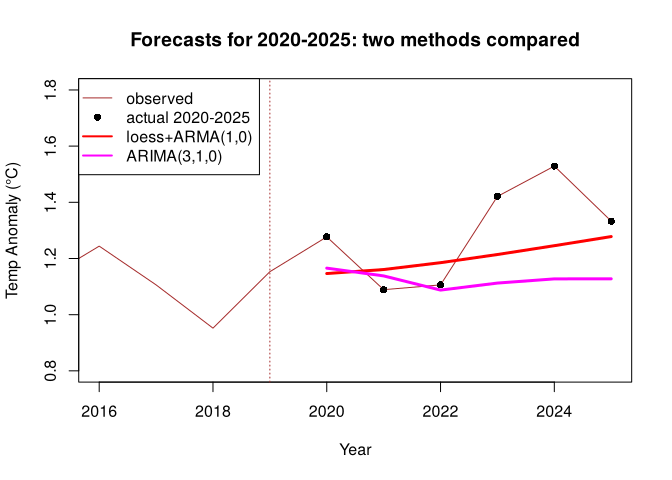

# Forecasting Northern Hemisphere Temperature Anomalies

Annual Northern Hemisphere temperature anomalies from 1850–2025 show a clear and accelerating warming trend. We modeled the series two ways, held out the six most recent years (2020–2025), and compared how well each approach forecast them.

*Team project for an upper-division time series analysis class at UC Davis.*
**Team:** Adi Pelled, Naomi Cohen, Jack Francis



## Results
| Approach | 2020–2025 forecast MSE |
|---|---|
| ARIMA(3,1,0) on the full series | 0.052 |
| **Loess trend + AR(1) on the residual "rough"** | **0.026** |

- **ARIMA(3,1,0)** was chosen by ACF/PACF, then confirmed as the lowest-AIC model in a grid over p, q ∈ {0,…,3}. All three AR terms are significant (AR1 = −0.376, SE 0.073), and a Ljung-Box test (p = 0.75) shows the residuals are white noise.
- **Loess + AR(1)** halved the forecast error. Separating the long-run warming trend from year-to-year noise extrapolated the recent acceleration better than differencing did.

## What's inside
| Path | What it is |
|---|---|
| `analysis.Rmd` | The full report: EDA, stationarity, model selection, diagnostics, forecasting |
| `analysis.md` | Rendered report you can read on GitHub (code appendix at the end) |
| `data/Temp_NH_1850_2025.csv` | Year + temperature anomaly (°C) |
| `figures/` | All charts |

## Methods
1. Plot the series and its ACF → strong trend, non-stationary.
2. **First difference** → constant mean/variance; ACF/PACF of the differences suggest AR(3).
3. AIC grid search → ARIMA(3,1,0); check residuals (histogram, Q-Q plot, ACF, Ljung-Box).
4. Alternative: **loess** smooth (span 0.75) for the trend, then an ARMA model on the rough (AIC picks AR(1)).
5. Train on 1850–2019, forecast 2020–2025, compare MSE.

## Run it
```r
install.packages(c("rmarkdown", "knitr", "Hmisc"))
rmarkdown::render("analysis.Rmd")
```

## Tools
R · base `arima` / `loess` / `acf` · Hmisc · R Markdown
