Forecasting Northern Hemisphere Temperature Anomalies
================
Adi Pelled, Naomi Cohen, Jack Francis

# 1 Introduction

The industrial revolution lasted from 1760 to 1914 and is one of the
largest accelerations of societal advancement in consumerism,
infrastructure, and technology. However, this also brought on a massive
increase in energy consumption worldwide. This came at the cost of our
natural environments. This pattern continued into the 2000s, and global
warming became a household topic. Now as we are one quarter into the new
century, the rapid advancement of AI and construction of data centers
brings **rising global temperatures** to the forefront of modern issues.
In this project **we will examine anomalies in the temperature of the
Northern Hemisphere**, collected by the **Climate Research Center at the
University of East Anglia, from 1850 to 2025** in order to determine the
rate at which global temperatures are increasing. By modeling this
change we can effectively predict what temperatures will be in the
future.

# 2 Materials and Methods

## 2.1 Data

The dataset we are going to model, “Temp_NH_1850_2025.csv”, has two
columns. The first is Year, identifying the year the temperature data
was recorded. The second is Temperature anomaly in degrees Celsius. This
indicates how different the average temperature for the year was
compared to a historic baseline. In this case, NASA established a global
baseline temperature from the years 1951 to 1980. **This data set is a
time series due to the nature of its data being recorded at regular
intervals, the end of each year**.

## 2.2 Methodology

To address the nonstationarity of the raw series, two modeling
approaches are compared.

**Approach 1: ARIMA(3,1,0)**

The trend is removed by first differencing and the result is modeled as:

$$\nabla x_t = \phi_1 \nabla x_{t-1} + \phi_2 \nabla x_{t-2} + \phi_3 \nabla x_{t-3} + \varepsilon_t$$

where $\nabla x_t = x_t - x_{t-1}$ is the year-over-year change in
temperature anomaly, $\phi_1, \phi_2, \phi_3$ are autoregressive
coefficients, and $\varepsilon_t \sim WN(0, \sigma^2)$.

**Approach 2: Loess + ARMA(1,0)**

The trend $\hat{m}_t$ is estimated via loess (span = 0.75) and
subtracted to obtain the rough $r_t = x_t - \hat{m}_t$, which is modeled
as:

$$r_t = \phi_1 r_{t-1} + \varepsilon_t$$

where $|\phi_1| < 1$ for stationarity. Forecasts combine the
extrapolated loess trend with the AR(1) rough forecast. Both models are
evaluated on held-out years 2020–2025 using MSE.

# 3 Results

## 3.1 Exploratory Data Analysis

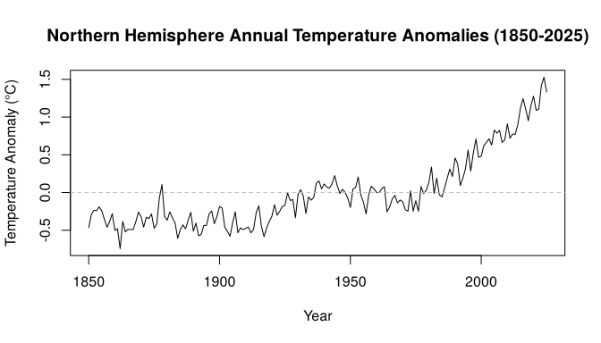

We can see from the years **1850 to 1925 that the temperature was mostly
lower than the baseline**. Then from **1926 to 1975 the temperature
hovered near the baseline**. Finally, from **1976 to 2025, the
temperature rapidly climbs to far above what was previously seen in the
late 1900s**. It is easy to see that the data trends upwards. In order
to perform analysis, we need the data to fluctuate around a constant
mean.

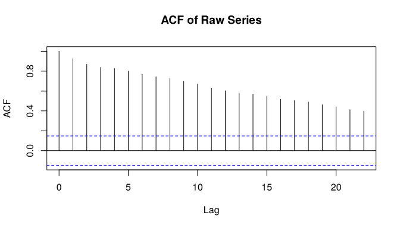

The autocorrelation function shows that as the lag time between any 2
given years increases, their temperature anomalies are less and less
correlated. However, the temperature of each year is highly correlated
to the others close in lag time. Years even as far as 20 lags (years)
apart still have a correlation higher than 0.4. The slow decay confirms
the series is nonstationary and must be transformed before modeling.

## 3.2 Model Results

In order to perform analysis, **we need the series to be stationary** by
meeting three assumptions: The data must **fluctuate around a constant
mean**; the data must have **equal variance in said fluctuations**; and
the **errors must be random white noise** with mean equal to 0 and
variance $\sigma^2$. To meet the assumption of a constant mean, we model
the difference in temperature anomalies of each year from the one
before.

### Modeling the First Difference

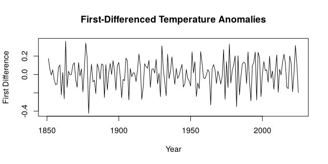

Now the data appears to have **equal variance around a constant mean**.
Visually, the year-to-year difference in temperature seems to fluctuate
in a range of -0.2 to 0.2 around 0 degrees.

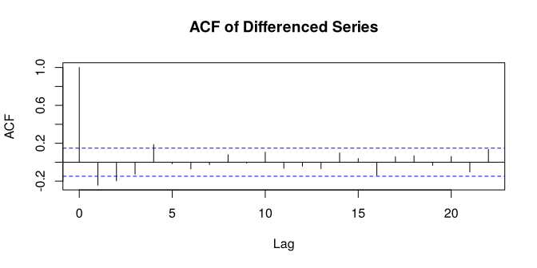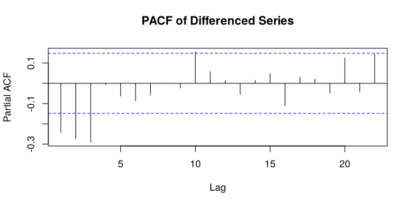

The ACF of the differenced series exhibits a **significant negative
spike at lag 1** followed by values within the confidence bounds,
suggesting an **MA(0)** component. The PACF shows significant **spikes
at lags 1 through 3** before dying out, suggesting an **AR component of
order 3**. Based on this preliminary identification, an **ARIMA(3,1,0)
model is considered as an initial candidate**, with the final model
order to be determined via AIC.

### AIC and Model Selection

An ARIMA(3,1,0) model was fit to the temperature anomaly series as the
preliminary candidate identified from the ACF and PACF analysis. R will
estimate the coefficients of the model and we will calculate an AIC
value based on this model.

|     | Coefficient | Standard_Error |
|:----|------------:|---------------:|
| ar1 |  -0.3763464 |      0.0728337 |
| ar2 |  -0.3542744 |      0.0737339 |
| ar3 |  -0.2843249 |      0.0735106 |

    [1] -193.5222

The estimated coefficients are **AR1 = −0.376 (SE = 0.073), AR2 = −0.354
(SE = 0.074), and AR3 = −0.284 (SE = 0.074)**. All three AR terms are
statistically significant, as each **estimate is more than 2 times its
standard error**. The **AIC of the preliminary model is −193.52**. These
coefficients describe how past changes in temperature anomalies
influence the current change. The negative signs indicate that an
increase in temperature anomaly in a given year tends to be followed by
a decrease in the subsequent year, and vice versa. However, the
magnitude of the coefficients decreases as lag increases, meaning the
**influence of past values weakens over time**. This suggests that most
of the most influential part of the model comes from recent anomalies,
particularly the past two years, with diminishing contribution from the
3rd past year. To be certain our model is the best predictor of
temperature anomalies well compare the AIC of 16 models with **p= 0, 1,
2 ,3** and **q=0, 1, 2 ,3**, where p is the AR order and q is the MA
order.

|       |   MA(0) |   MA(1) |   MA(2) |   MA(3) |
|:------|--------:|--------:|--------:|--------:|
| AR(0) | -162.23 | -183.76 | -189.11 | -187.11 |
| AR(1) | -170.47 | -187.29 | -187.11 | -187.56 |
| AR(2) | -181.21 | -189.31 | -190.71 | -190.23 |
| AR(3) | -193.52 | -191.54 | -189.76 | -188.50 |

The model with the **lowest AIC is MA(0) & AR(3) corresponding to
ARIMA(3,1,0)**, meaning that the best fit to the data, without
overparameterizing, is by representing the first differences of the
series with a 3rd-degree autoregressive model. This will be our final
model, pending verification of assumptions in the diagnostics section:

$$ \nabla x_t=\phi_1(\nabla x_{t-1}) + \phi_2(\nabla x_{t-2}) + \phi_3(\nabla x_{t-3}) + \epsilon_t$$

where $\epsilon_t \sim WN(0, \sigma^2)$ and
$\nabla x_t = x_t - x_{t-1}$. Thus our final model for temperature
anomalies in the Northern Hemisphere is:

$$ \nabla x_t = (-0.376) \nabla x_{t-1} + (-0.354) \nabla x_{t-2} + (-0.284) \nabla x_{t-3} + e_t $$

## 3.3 Model Diagnostics

### Diagnostic Plots

| Term  | Estimate | Std. Error | t-statistic |
|:------|---------:|-----------:|------------:|
| AR(1) |  -0.3763 |     0.0728 |     -5.1672 |
| AR(2) |  -0.3543 |     0.0737 |     -4.8048 |
| AR(3) |  -0.2843 |     0.0735 |     -3.8678 |

ARIMA(3,1,0) Coefficient Estimates

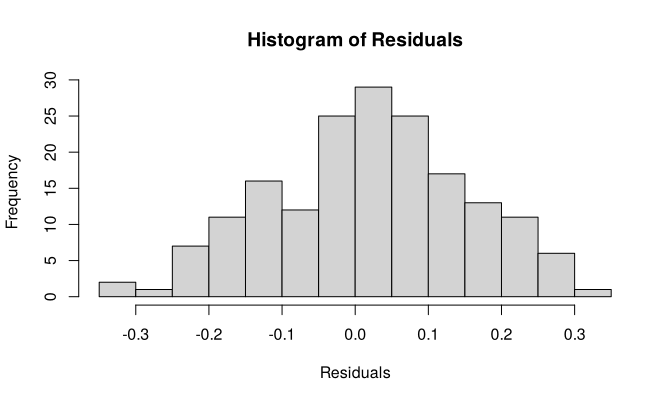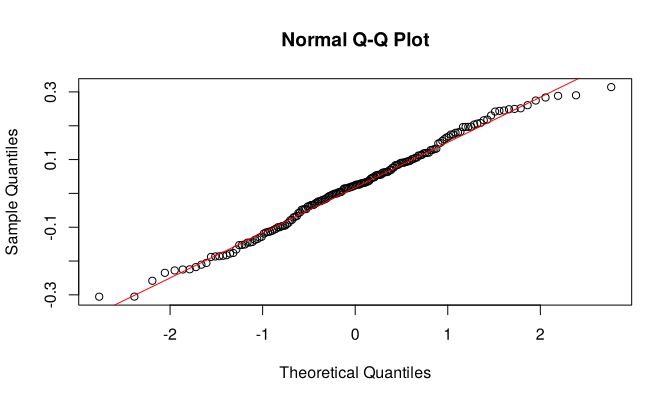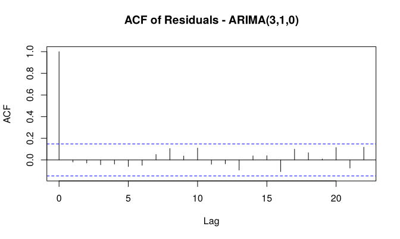

Looking at the plot of residuals from the ARIMA(3,1,0), we can see that
the **distribution of the residuals is approximately normal**.
Furthermore, the Normal Q-Q plot demonstrates that the residuals are
aligned with the theoretical normal quantities, suggesting the errors
are normally distributed. Finally, the **ACF plot of the residuals shows
little to no correlation between the residuals**, suggesting that they
are independent from each other. All these **plots seem to indicate that
the residuals are white noise**, which would satisfy our final condition
for a stationary series. However, we need to perform an official test to
determine whether or not that is the case.

### Ljung-Box Test

The cutoff for the Ljung-Box test for white noise will be the square
root of the total number of observations. Because we have data on 174
differences in temperature between years (1 less than the total number
of years) we will **test for 13 lags**. The null hypothesis is that the
errors are not correlated and hence are white noise. The alternative
hypothesis is that at least two of the errors are correlated and thus
not white noise. We will now perform the test.


        Box-Ljung test

    data:  fit_final$residuals
    X-squared = 9.2873, df = 13, p-value = 0.7509

The Ljung-Box test concluded a **p-value of 0.7509**, meaning we **fail
to reject the null** hypothesis and conclude that **the errors of the
ARIMA(3,1,0) model are white noise**. This confirms that the series is
stationary.

## 3.4 Forecasting

In order to test the accuracy of the forecasting, we will **fit a model
excluding the 6 most recent years (2020, 2021, 2022, 2023, 2024, and
2025) and forecast them**. This will allow us to observe how close our
forecasted anomalies are compared to the actual data. Furthermore, we
will **compare forecasting by different methods**, estimating the trend
by loess and plotting the data and the fitted trend on the same graph.

### Loess trend + ARMA on rough

First we need to **model the trend** of the temperature anomalies data
by Loess. Loess models the trend through locally weighted polynomial
regression.

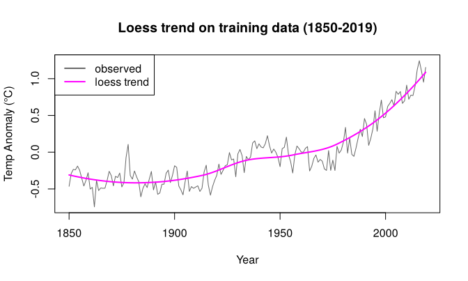

Now that we have a trend fitted to the data, we can **subtract it from
the original data** in order to center fluctuations around a constant
mean. This will give us the rough of the data. Then, by looking at the
ACF and PACF plots we can estimate an ARMA model.

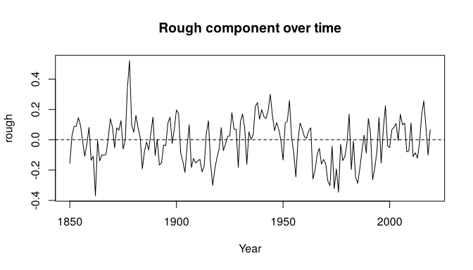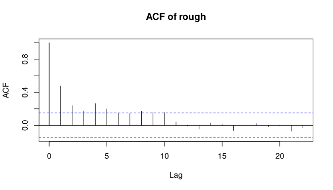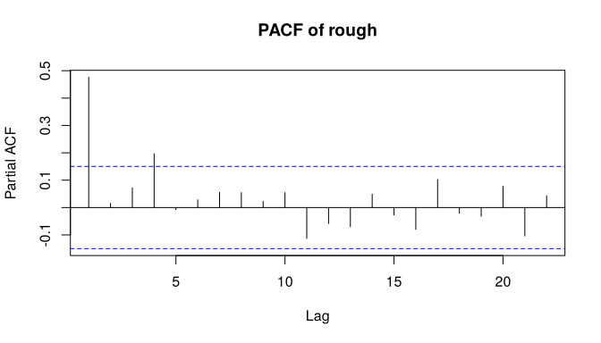

The ACF of the series exhibits significant positive spikes at lags 0, 1,
and 2. After the **ACF trails off** as lags increase. This pattern is
broadly consistent with AR models suggesting there is **not a MA
component** to the series. The PACF shows a **significant spike at lag
1** followed by values within the confidence bounds, suggesting an **AR
component of order 1**. Given these observations, our initial model is
**ARMA(1,0)**. To be certain before forecasting anomalies, we will once
again create a table of AIC values and compare the AIC from 16 models
with **p = 0, 1, 2, 3** and **q = 0, 1, 2, 3**.

            q=0     q=1     q=2     q=3
    p=0 -167.63 -200.96 -206.97 -205.07
    p=1 -209.50 -207.54 -205.36 -207.79
    p=2 -207.53 -208.45 -207.46 -207.87
    p=3 -206.41 -208.35 -209.00 -208.11

    best ARMA order: p = 1 , q = 0 

The model with the **lowest AIC is ARMA(1,0)**, meaning that the best
fit to the data, without overparameterizing, is by representing the
rough of the series with a 1st-degree autoregressive model. This will be
our final model that will be used for forecasting.

### Forecasting 2020-2025

Now that we have fit 2 separate models excluding the 6 most recent years
of data, we will **forecast the temperature anomalies of those same 6
years** in order to evaluate how effective each model’s predictions are.
The **ARIMA(3,1,0) predictions will be shown in magenta** while the
**Loess + ARMA(1,0) predictions will be shown in red**. For ease of
comparison the actual anomalies will be shown in black.

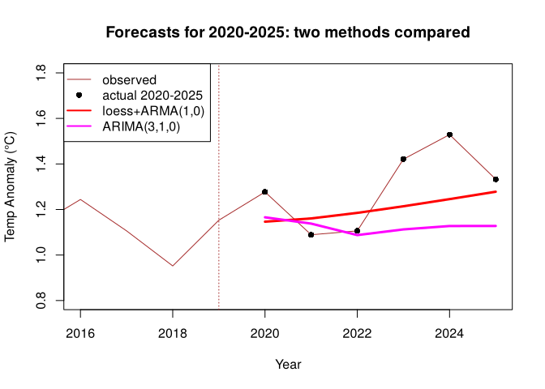<!-- -->

The ARIMA(3,1,0) model is very accurate at predicting 2022’s temperature
anomalies but overestimates 2021 and underestimates 2020, 2023, 2024,
and 2025. In contrast, Loess + ARMA(1,0) underestimates 2020, 2023,
2024, and 2025 and overestimates 2021 and 2022. **Overall the Loess ARMA
model seems to have less prediction error** compared to the ARIMA model,
suggesting it is a better predictor of temperature anomalies. We will
calculate each model’s mean squared error for the 6 forecasted years to
have a more concrete idea of the accuracy of their predictions.

| Model        |   MSE |
|:-------------|------:|
| ARIMA(3,1,0) | 0.052 |
| ARMA(1,0)    | 0.026 |

Mean squared error confirmed what we theorized from the previous plot.
The MSE of the ARIMA model is more than twice that of the Loess + ARMA
model, suggesting the Loess + ARMA approach is far better at forecasting
future temperature anomalies.

## 3.5 Discussion and Conclusion

The analysis of Northern Hemisphere temperature anomalies from 1850 to
2025 reveals a clear and accelerating warming trend, particularly after
1976. Using time series methods, we identified ARIMA(3,1,0) as our final
model through AIC model selection, with diagnostics confirming it was an
adequate fit. When comparing the two forecasting methods, MSE over the 6
predicted years revealed that Loess+ARMA(1,0) (MSE = 0.0258)
outperformed ARIMA(3,1,0) (MSE = 0.0522), suggesting the decomposition
approach better captured the underlying structure of the series. One
limitation is that forecasting only 6 years ahead may not be enough to
fully evaluate long-term model performance. Overall, both models confirm
that Northern Hemisphere temperatures have risen significantly since
1850 and will most likely continue to do so.

``` r
knitr::opts_chunk$set(echo = FALSE, comment = NA, message = FALSE, warning = FALSE, fig.path = "figures/")
data <- read.csv("data/Temp_NH_1850_2025.csv", header=FALSE)
colnames(data) <- c("year", "value")
data$year <- as.numeric(data$year)
data$value <- as.numeric(data$value)
plot(data$year, data$value, type="l",
     xlab="Year", ylab="Temperature Anomaly (°C)",
     main="Northern Hemisphere Annual Temperature Anomalies (1850-2025)")
abline(h=0, lty=2, col="gray")
acf(data$value, main="ACF of Raw Series")
#taking first difference:
anomaly_diff <- diff(data$value)
plot(data$year[-1], anomaly_diff, type="l",
     xlab="Year", ylab="First Difference",
     main="First-Differenced Temperature Anomalies")
acf(anomaly_diff, main="ACF of Differenced Series")
pacf(anomaly_diff, main="PACF of Differenced Series")

fit_prelim <- arima(data$value, order=c(3,1,0))
coef <- fit_prelim$coef
coef.se <- sqrt(diag(fit_prelim$var.coef))
coef.df <- data.frame( Coefficient = coef,  Standard_Error = coef.se)
knitr::kable(coef.df)
fit_prelim$aic
aic_table <- matrix(NA, nrow=4, ncol=4)
rownames(aic_table) <- paste0("AR(", 0:3, ")")
colnames(aic_table) <- paste0("MA(", 0:3, ")")
for(p in 0:3){
  for(q in 0:3){
    fit <- tryCatch(arima(data$value, order=c(p,1,q)), error=function(e) NULL)
    if(!is.null(fit)) aic_table[p+1, q+1] <- AIC(fit)
  }
}
knitr::kable(round(aic_table, 2))

#sanity check:
## AIC(arima(data$value, order=c(3,1,0)))
## AIC(arima(data$value, order=c(3,1,2)))
## AIC(arima(data$value, order=c(3,1,1)))
# extract coefficients and standard errors from the model
fit_final <- arima(data$value, order=c(3,1,0))

coef_table <- data.frame(
  Term = c("AR(1)", "AR(2)", "AR(3)"),
  Estimate = fit_final$coef,
  Std_Error = sqrt(diag(fit_final$var.coef)),
  t_stat = fit_final$coef / sqrt(diag(fit_final$var.coef))
)

knitr::kable(coef_table,
             col.names = c("Term", "Estimate", "Std. Error", "t-statistic"),
             digits = 4,
             caption = "ARIMA(3,1,0) Coefficient Estimates",
             align = c("l", "r", "r", "r"),
             row.names = FALSE)

hist(fit_final$residuals, breaks=15, main="Histogram of Residuals", xlab="Residuals")
qqnorm(fit_final$residuals)
qqline(fit_final$residuals, col="red")
acf(fit_final$residuals, main="ACF of Residuals - ARIMA(3,1,0)")
Box.test(fit_final$residuals, lag=13, type="Ljung-Box")
# split: train on 1850-2019, hold out 2020-2025 for forecasting
train <- data[data$year <= 2019, ]
test  <- data[data$year > 2019, ]

# fit loess smoother to training data, span=0.75 controls smoothness
lo <- loess(value ~ year, data = train, span = 0.75)
trend_hat <- predict(lo)

# plot observed series and loess trend on same graph
plot(train$year, train$value, type = "l", col = "gray40",
     xlab = "Year", ylab = "Temp Anomaly (°C)",
     main = "Loess trend on training data (1850-2019)")
lines(train$year, trend_hat, col = "magenta", lwd = 2)
legend("topleft", legend = c("observed", "loess trend"),
       col = c("gray40", "magenta"), lwd = 2)
# rough = data minus trend
rough <- train$value - trend_hat

plot(train$year, rough, type = "l",
     xlab = "Year", ylab = "rough",
     main = "Rough component over time")
abline(h = 0, lty = 2)

# ACF and PACF of rough
acf(rough, main = "ACF of rough")
pacf(rough, main = "PACF of rough")
# fit ARMA(p,q) for all p,q in 0:3 and store AIC values
# Vectorize() lets outer() pass one (p,q) at a time into arima()
aic_tab <- outer(0:3, 0:3, Vectorize(function(p, q)
  AIC(arima(rough, order = c(p, 0, q)))))
rownames(aic_tab) <- paste0("p=", 0:3)
colnames(aic_tab) <- paste0("q=", 0:3)
round(aic_tab, 2)

# pick best model = lowest aic
best <- which(aic_tab == min(aic_tab, na.rm = TRUE), arr.ind = TRUE)
best_p <- best[1] - 1
best_q <- best[2] - 1
cat("best ARMA order: p =", best_p, ", q =", best_q, "\n")
library(Hmisc)

# extrapolate loess trend to 2020-2025 using linear extrapolation
trend_future <- approxExtrap(train$year, trend_hat, xout = test$year)$y

# fit best ARMA model to rough and forecast 6 steps ahead
rough_fit <- arima(rough, order = c(best_p, 0, best_q))
rough_fc  <- as.numeric(predict(rough_fit, n.ahead = 6)$pred)

# loess+ARMA forecast = extrapolated trend + rough forecast
fc_loess <- trend_future + rough_fc

# ARIMA(3,1,0) forecast on training data for comparison
fc_arima <- as.numeric(predict(arima(train$value, order = c(3,1,0)), n.ahead = 6)$pred)

# plot full observed series
plot(data$year, data$value, type = "l", col = "brown",
     xlab = "Year", ylab = "Temp Anomaly (°C)",
     main = "Forecasts for 2020-2025: two methods compared",
     xlim = c(2016, 2025), ylim = c(0.8,1.8))

# overlay both forecasts
lines(test$year, fc_loess, col = "red", lwd = 3)
lines(test$year, fc_arima, col = "magenta", lwd = 3)

# actual 2020-2025 values for visual comparison
points(test$year, test$value, pch = 16, col = "black")  # actual values

# vertical line marking end of training period
abline(v = 2019, lty = 3, col = "brown")
legend("topleft",
       legend = c("observed", "actual 2020-2025", "loess+ARMA(1,0)", "ARIMA(3,1,0)"),
       col = c("brown", "black", "red", "magenta"),
       lwd = c(1, NA, 2, 2), pch = c(NA, 16, NA, NA))
#  MSE comparison for 6 predicted years
actual <- test$value
err_arima <- actual - fc_arima
err_loess <- actual - fc_loess

mse_arima <- (sum(err_arima^2))/length(actual)
mse_loess <- (sum(err_loess^2))/length(actual)
mse.df <- data.frame( Model = c("ARIMA(3,1,0)","ARMA(1,0)") , MSE = round(c(mse_arima,mse_loess),3))
knitr::kable(mse.df)
```
